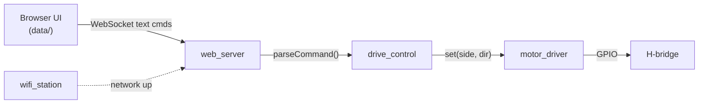

# ESP32 RC Car (Web Controlled)

Firmware for a two-motor (differential drive) RC car. An ESP32 serves a control page over Wi‑Fi, and the page sends drive commands back to the car over a WebSocket. Driving is hold-to-move: the car runs while you press a button and stops when you let go.

## Features

- Web controller served from the ESP32's flash (LittleFS) that works on phone and desktop browsers
- Low-latency command channel over a WebSocket (`/ws`)
- Hold-to-drive controls using pointer events, which stops the car when the button is released, the page loses focus, or the tab is hidden
- Layered firmware: hardware driver → drive logic → transport
- Credentials kept out of source control (`include/secrets.h` is git-ignored)

## Hardware

| Component | Notes |
|---|---|
| ESP32 DevKit (ESP32-WROOM-32) | `board = esp32dev` |
| Dual H-bridge (L298N / L293D) | On/off direction control |
| 2 × DC gear motors + chassis | Differential drive |
| Battery pack | Powers the motors; share GND with the ESP32 |

### Pin map

| ESP32 GPIO | H-bridge input | Motor |
|---|---|---|
| 33 | IN1 | Left |
| 25 | IN2 | Left |
| 26 | IN3 | Right |
| 27 | IN4 | Right |

All pins are defined in [`include/config.h`](include/config.h).

## Firmware architecture



```
├── include/
│   ├── config.h              # Pins, ports, timing constants
│   └── secrets.example.h     # Template → copy to secrets.h (git-ignored)
├── src/
│   ├── main.cpp              # Entry point / module wiring
│   ├── motor_driver.*        # H-bridge pin control (hardware layer)
│   ├── drive_control.*       # Command parsing + command → motor mapping
│   ├── wifi_station.*        # Wi-Fi STA connection
│   └── web_server.*          # HTTP + WebSocket server
├── data/                     # Web UI, flashed as a LittleFS image
│   ├── index.html
│   ├── style.css
│   └── app.js
└── platformio.ini
```

### Command protocol

| Message | Action |
|---|---|
| `up` | Both motors forward |
| `down` | Both motors reverse |
| `left` | Right motor forward (pivot left) |
| `right` | Left motor forward (pivot right) |
| `off` | Stop |

## Build & flash

Prerequisites: [PlatformIO](https://platformio.org/) (VS Code extension or `pip install platformio`).

```bash
# 1. Wi-Fi credentials
cp include/secrets.example.h include/secrets.h   # then edit it

# 2. Build and flash firmware
pio run -t upload

# 3. Flash the web UI (LittleFS image from data/)
pio run -t uploadfs

# 4. Watch the serial log to get the car's IP address
pio device monitor
```

Then open `http://<car-ip>/` on a device connected to the same network.

## Roadmap

- [x] **Tier 0:** PlatformIO project, modular code, secrets out of source, UI on LittleFS, buffer-overflow fix
- [ ] **Tier 1:** FreeRTOS tasks + queues, PWM speed control, heartbeat fail-safe, watchdog, state machine
- [ ] **Tier 2:** Encoders + PID, custom IMU driver, ToF emergency braking, telemetry, OTA with rollback
- [ ] **Tier 3:** CAN-connected motor ECU / Edge AI / Zephyr port
