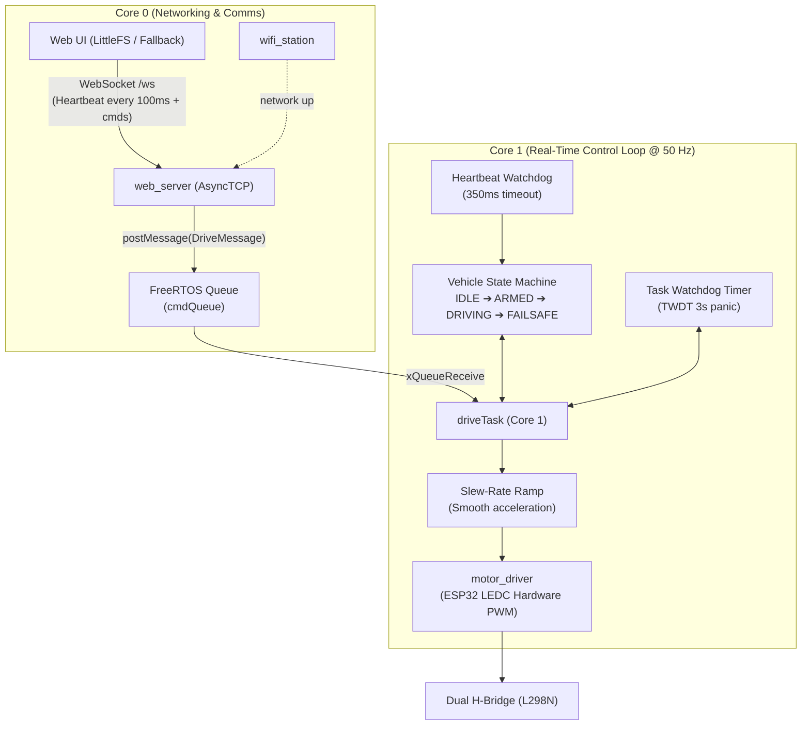

# ESP32 RC Car (Web Controlled)

Firmware for a two-motor (differential drive) RC car. An ESP32 serves a control page over Wi‑Fi, and the page sends drive commands back to the car over a WebSocket. Driving is hold-to-move: the car runs while you press a button and stops when you let go.

## Features

- Web controller served from the ESP32's flash (LittleFS) that works on phone and desktop browsers
- Low-latency command channel over a WebSocket (`/ws`)
- Hold-to-drive controls using pointer events, which stops the car when the button is released, the page loses focus, or the tab is hidden
- Layered firmware: hardware driver → drive logic → transport
- Credentials kept out of source control (`include/secrets.h` is git-ignored)

## Hardware

| Component | Notes |
|---|---|
| ESP32 DevKit (ESP32-WROOM-32) | `board = esp32dev` |
| Dual H-bridge (L298N / L293D) | On/off direction control |
| 2 × DC gear motors + chassis | Differential drive |
| Battery pack | Powers the motors; share GND with the ESP32 |

### Pin map

| ESP32 GPIO | H-bridge input | Motor |
|---|---|---|
| 33 | IN1 | Left |
| 25 | IN2 | Left |
| 26 | IN3 | Right |
| 27 | IN4 | Right |

All pins are defined in [`include/config.h`](include/config.h).

## Firmware architecture (Tier 1)



```
├── include/
│   ├── config.h              # Pins, LEDC PWM, FreeRTOS and safety constants
│   └── secrets.example.h     # Template → copy to secrets.h (git-ignored)
├── src/
│   ├── main.cpp              # Entry point & module orchestration
│   ├── system_diagnostics.*  # Boot reset-reason decoding & Task Watchdog (TWDT)
│   ├── motor_driver.*        # ESP32 LEDC hardware PWM driver (0..255)
│   ├── drive_control.*       # FreeRTOS driveTask, queue, FSM, slew ramp, heartbeat
│   ├── wifi_station.*        # Wi-Fi STA connection (supports hardware & Wokwi)
│   └── web_server.*          # Async HTTP + WebSocket command & telemetry channel
├── data/                     # Web UI, flashed as a LittleFS image
│   ├── index.html            # D-pad controls, vehicle state badge, speed slider
│   ├── style.css
│   └── app.js                # Continuous 100ms heartbeat & hold-to-drive
├── diagram.json              # Wokwi simulation circuit (ESP32, LEDs, Logic Analyzer)
├── wokwi.toml                # Wokwi configuration file
└── platformio.ini
```

### Command protocol

| Message | Action |
|---|---|
| `up` | Drive forward with smooth acceleration |
| `down` | Drive reverse with smooth acceleration |
| `left` | Differential pivot left |
| `right` | Differential pivot right |
| `off` | Stop (target speed = 0, ramped deceleration) |
| `hb` | Heartbeat keepalive (sent by client every 100ms) |
| `speed:<val>` | Dynamic PWM speed configuration (50..255) |

## Simulation with Wokwi

You can run and test this entire firmware directly in the Wokwi simulator without physical hardware!

1. Install the **Wokwi** VS Code extension (`wokwi.wokwi-vscode`).
2. Build the simulation target:
   ```bash
   pio run -e wokwi
   ```
3. Open [`diagram.json`](diagram.json) in VS Code and press **Start Simulation** (or press `F1` and select `Wokwi: Start Simulator`).
4. In simulation:
   - The ESP32 automatically connects to `Wokwi-GUEST`.
   - The 4 LEDs display real-time PWM speed and direction:
     - **GPIO 33 (Green):** Left Motor Forward
     - **GPIO 25 (Red):** Left Motor Reverse
     - **GPIO 26 (Green):** Right Motor Forward
     - **GPIO 27 (Red):** Right Motor Reverse
     - **GPIO 2 (Blue):** State Indicator (Solid = Armed/Driving, Blinking = Failsafe)
   - The built-in 8-channel logic analyzer records PWM frequencies, duty cycles, and command-to-motor latencies.
   - The web controller opens directly at the IP printed on the virtual serial monitor.

## Build & flash (Real Hardware)

Prerequisites: [PlatformIO](https://platformio.org/) (VS Code extension or `pip install platformio`).

```bash
# 1. Wi-Fi credentials
cp include/secrets.example.h include/secrets.h   # then edit it

# 2. Build and flash firmware
pio run -e esp32dev -t upload

# 3. Flash the web UI (LittleFS image from data/)
pio run -e esp32dev -t uploadfs

# 4. Watch the serial log to get the car's IP address
pio device monitor
```

Then open `http://<car-ip>/` on any device on the same local network.
